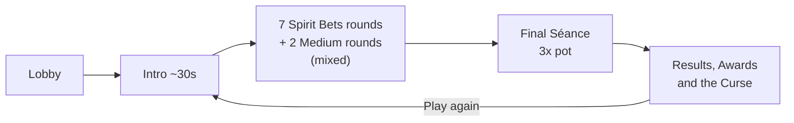
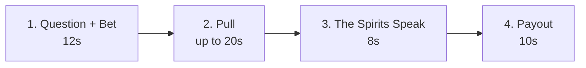
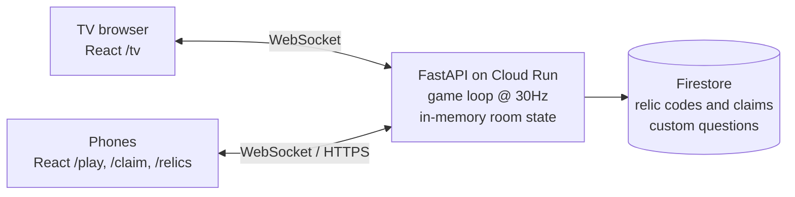

# 👻 Spirit Board: Design Doc (Draft v0.3)

*Working title. A Jackbox-style Halloween party game for the Spooktacular party.*

| | |
|---|---|
| **Owner / Host** | willyn |
| **Players** | 3–10 (tuned for ~10) |
| **Length** | ~15 minutes, built to be replayed |
| **Platforms** | TV (browser), phones (browser, nothing to install) |
| **Stack** | React + TypeScript (frontend), Python (backend), GCP |
| **Tone** | 🌶️ Spicy (adults only) |
| **Status** | 🟡 Draft, iterating |

> [!NOTE]
> **What changed in v0.3:** Poltergeists, candles, and voting are **gone**. The game now has two round types: **Spirit Bets** (a free-for-all tug-of-war with secret bets) and **Medium rounds** (one player answers privately, everyone else tries to guess it). It adds **Haunted curses** and a **Final Séance**, and the Insight Relics have been reworked.

---

## 1. Pitch

The TV shows an old Ouija board. A question appears: *"Who in this room would be the first to die in a horror movie?"* Everyone secretly **bets** on where the planchette will land, and then all 10 phones drag it **at the same time**. Alliances form and fall apart out loud, Kevin fights to keep the planchette away from his own name, and someone casts a Mirror Curse at the last second.

Some rounds are **Medium rounds**: one player privately answers a personal question, and everyone else works together to land on what they think that player picked. Then the Medium has to explain themselves.

Clues from your scavenger hunt carry **QR codes**. Scanning one gives you a **Relic**, a one-time power to bend the séance your way.

### Design pillars
1. **Funny first.** The questions are about the people in the room.
2. **Everyone plays at once.** Every phone is pulling in every round.
3. **No hidden roles.** Everything you see is what's happening. All the scheming happens out loud. *(new)*
4. **Fast rounds.** About 1 minute each, so a bad round is over quickly.
5. **The hunt helps but isn't required.** Relics make the game more fun, but it works without them.

---

## 2. Game flow

### 2.1 Lobby (~1–2 min)
- The TV shows the room code and a QR code to join. Each player enters a name and picks a ghost avatar and color.
- Relics scanned during the hunt are already on that phone and show up automatically (§6.5).
- The host taps **Begin the Séance**.

### 2.2 Round order
- 9 rounds plus the Final Séance. **Medium rounds** go in slots 3 and 7 (or two random slots in the middle, never round 1).
- The host can set the game length: Short (6 rounds), **Standard (9, default)**, or Long (12).

### 2.3 Timing estimate
| Segment | Time |
|---|---|
| Lobby + intro | ~2:00 |
| 7 × Spirit Bets (~50s) | ~5:50 |
| 2 × Medium (~75s) | ~2:30 |
| Final Séance | ~1:15 |
| Results, awards, curse | ~1:30 |
| Banter / slack | ~2:00 |
| **Total** | **~15 min** |

---

## 3. Round type A: Spirit Bets 🎲

| Phase | TV | Phone |
|---|---|---|
| **1. Question + Bet** | The question, answer spots, and the **pot** (e.g. 🍬 500) | Tap an answer to **secretly bet** on it. Bet-phase Relics available |
| **2. Pull** | Live planchette, pull aura, timer, Relic announcements | Touchpad: drag to pull. Pull Relics available |
| **3. The Spirits Speak** | Answer revealed with a funny line: *"The spirits have spoken… **KEVIN** would die first. He went to investigate a noise."* | Reaction emojis |
| **4. Payout** | **Bets revealed** as avatars on each spot (*"4 of you bet Kevin. Kevin bet Dave."*). Winners split the pot | Points won |

### 3.1 Rules
- **One secret bet per player.** If you don't bet, a random answer is picked for you (and the TV teases you about it).
- **You can bet on yourself.** Betting that the board will pick *you* for "most likely to hook up with the ghost" is a fun move.
- **Lock-in:** the planchette locks onto an answer when it **stays inside a spot for 2 seconds**. If time runs out, it goes to the nearest spot.
- **Split pot:** pot = **50 × number of players** (500 with 10 players). Everyone who bet on the winning answer splits it evenly. *(The multiplier is configurable and will be tuned in playtesting.)*
  - Lone winner → 500. Five winners → 100 each. This rewards bold, contrarian bets and getting other people to pull with you.
- **Rollover:** if nobody bet on the winning answer, *"the spirits keep the candy"* and the pot carries over to the next round. 🍬📈

### 3.2 Why this works without roles
- Everyone has a stake, but nobody knows the others' bets, so players **bluff and recruit out loud**: *"Pull to Priya, I swear I bet Priya!"* (They bet Dave.)
- The person whose name is on a spot usually fights hard to keep the planchette away. Instant comedy.
- The bet reveal at the end is the payoff: who lied, who betrayed whom, who bet on themselves.

---

## 4. Round type B: The Medium 👁️

| Phase | TV | Phone (Medium) | Phone (everyone else) |
|---|---|---|---|
| **1. Medium Answers** | *"🔮 **SARAH** is consulting the spirits…"* plus the question | Secretly picks their **honest** answer | Waiting screen with spooky animation |
| **2. Guess** | Same question | Watches | Secretly **guesses** the Medium's answer |
| **3. Pull** | Live planchette | **Doesn't pull**, but can use Chaos Relics | Pull toward what you think the Medium picked |
| **4. Reveal** | Planchette lands, then the **Medium's real answer** is revealed dramatically | — | — |
| **5. Explain Yourself** | *"Sarah… explain yourself."* with a 15s timer | — | Reaction emojis |

### 4.1 Rules
- The Medium **rotates**: each player can be the Medium at most once per game, picked at random.
- On a "Who In This Room" board, the Medium's **own name is removed** from the spots.
- **Scoring (mostly co-op, a little competitive):**
  - Each correct guesser: **+100**
  - Board lands on the Medium's answer: **+100 to everyone** (including the Medium)
  - Medium: **+50 per correct guesser**, which rewards answering honestly and predictably
- People still disagree about what the Medium picked, so the pull is still messy, just with everyone trying to land on the same right answer.

### 4.2 Medium questions (🌶️)
- Who in this room would you trust to help you hide a body?
- Who here would you *least* want to be stuck in a haunted elevator with?
- Who in this room would you sacrifice first to save yourself from the demon?
- Who here would you call to bail you out of ghost jail?
- Which person here would you want haunting your ex?
- *Pick One:* What would you do if the ghost was hot? → Run · Flirt · Move in · Start a podcast

---

## 5. Board types, questions, Haunted, finale

### 5.1 Board types
| Board type | Answer spots | Example |
|---|---|---|
| **🧑‍🤝‍🧑 Who In This Room** (most rounds) | Every player's name | *"Who would be the first to die in a horror movie?"* |
| **✅ Yes / No / Maybe** | YES · NO · MAYBE · ASK AGAIN | *"Will {player} survive the night?"* |
| **🎃 Pick One** | 4–6 silly options | *"What's actually haunting this house?"* |
| **🔢 Numbers** | 0–9 | *"How many minutes would {player} last in a haunted asylum?"* |

### 5.2 Spirit Bets questions (🌶️ starter deck)
**Who In This Room…**
- …would be the first to die in a horror movie?
- …would hook up with the ghost instead of running?
- …would sell out the whole group to the demon for \$50?
- …has the most haunted search history?
- …would get possessed and nobody would notice?
- …would read the cursed book out loud "just to see"?
- …would try to start an OnlyFans with the ghost?
- …would charge the demon rent?
- …is most likely to have a body in their basement?
- …would survive the horror movie by sacrificing everyone else?

**Yes / No / Maybe**
- Is {player} the real reason the lights keep flickering?
- Has {player} ever ghosted someone worse than an actual ghost?
- Would {player} survive a zombie apocalypse past day 2?

**Pick One**
- *What is {player}'s ghost form?* → A sad Victorian child · A slutty poltergeist · An HOA ghost · A ghost who only haunts Costco
- *What's in {player}'s cursed basement?* → Their browser history · 400 Crocs · Another basement · Their ex

### 5.3 Host custom questions ⭐
On the admin page you can add inside-joke questions (marked as Spirit Bets or Medium), and flag them "always include."
- Implementation: who / yes-no / pick (2–5 options, 16 chars each); text 5–140 chars, cleaned server-side; max 200 questions, stored in Firestore `questions`. "Always include" questions are spread randomly over the remaining rounds of their kind, so all of them play but not all up front. With fewer than 3 players, Medium questions don't play (no Medium rounds). Questions are loaded when a game starts.

### 5.4 Deck rules
- Mix per game: mostly Who In This Room, plus at least one Yes/No and one Pick One or Numbers.
- `{player}` gets filled with a random joined player. Don't pick the same person twice in one game.
- Don't repeat a question within a session. Tone toggle defaults to 🌶️ Spicy.

### 5.5 Haunted 👻 (ties in your party's penalty tradition)
- Every time the board lands on **your name**, you get a 💀 **Haunted mark**.
- **In-game curses (host toggle, on by default):** the first time each round's answer is a player, the TV deals that player a **curse card** for the next round:
  - *"Speak only in a ghost voice until the next round."*
  - *"You must narrate everything you do like a horror movie trailer."*
  - *"Hold your phone in your non-dominant hand."*
  - 🍺 *"Take a sip every time someone says your name."*
  - 🍺 *"Drink for every player who bet on you this round."*
  - 🍺 *"Ghostly Gulp: drink while the TV counts down 3 seconds."*
  - 🍺 *"Pick a drinking buddy. They drink whenever you do until the next round."*
  - 🍺 *"Toast the spirits: give a dramatic 10-second toast, then drink."*
  - 🍺 Curse cards marked 🍺 are always **"drink *or* take a non-drinking option"** (e.g., eat a candy corn), so nobody is pressured.
- **The Final Curse:** whoever ends with the **most Haunted marks** gets a real-life penalty from the host's penalty pile (or one the game picks).

### 5.6 Final Séance (finale)
- A Spirit Bets round with a **3× pot**, its own question (*"Who in this room is going to hell first?"*), and **no limit on Relics**. Use everything you've saved.
- Dramatic music and a slow reveal. Big swings at the end keep everyone in the game.

### 5.7 Results & Awards
- 👑 **Grand Medium:** highest score
- 💀 **Most Haunted:** the most Haunted marks, and gets the Final Curse
- 🐺 **Lone Wolf:** most solo pot wins
- 🧠 **Mind Reader:** most correct guesses in Medium rounds
- 📖 **Open Book:** the Medium whose answer the most people guessed
- 🤥 **Biggest Liar:** most rounds pulling *away* from their own bet (we track pull vs. bet)
- 🧲 **Strongest Pull:** dragged the hardest

---

## 6. Relics (scavenger hunt integration) 🔮

### 6.1 Rules
- **Public use:** the TV announces who used a Relic and on whom. *"🙃 **DAVE** cast the MIRROR CURSE on **KEVIN**!"* Only 👻 **Ghost Whisper** is anonymous.
- **Single-use**, **max 1 Relic per player per round** (no limit in the Final Séance).
- A full-screen Relic card with a one-line explanation shows on the TV every time a Relic is used, so everyone learns them as they come up.
- **Harder clues give better Relics** (§6.3).

### 6.2 Relic catalog (13)

**🖐️ Pull Relics (during the Pull)**
| Relic | Effect |
|---|---|
| 🙃 **Mirror Curse** | Pick a player. Their controls are **reversed** for this pull |
| 🧊 **Hex of Stillness** | Freeze a player's input for 6 seconds (their phone shows ice cracking) |
| 🧂 **Salt Circle** | Protect one answer spot. The planchette **can't land there** this round |
| 🧲 **Cursed Magnet** | Put a magnet on a spot. It pulls the planchette toward it slightly all round |
| 💪 **Iron Grip** | Your pull counts 3× for 8 seconds |
| 🌀 **Ouija Shuffle** | The answer spots **rearrange** halfway through the pull |
| ⏪ **Séance Rewind** | Snap the planchette back to where it was **5 seconds ago** *(reworked from Séance Replay)* |

**🎲 Bet Relics (during Question + Bet, or Pull)**
| Relic | Effect |
|---|---|
| 🔮 **Crystal Ball** | Spirit Bets: see **how many players bet on each spot**, live. Medium round: **two wrong answers are crossed out** on your phone *(reworked)* |
| 🃏 **Tarot Card** | **Change your bet** during the pull *(reworked)* |
| ✖️ **Double Down** | If your bet wins, your share is **doubled** *(reworked from Phantom Vote)* |
| 🩸 **Blood Pact** | Bind yourself to another player: **you also get whatever they win** this round, so now you're pulling for their bet *(reworked)* |

**🗣️ Chaos Relics (any time; the Medium can use these too)**
| Relic | Effect |
|---|---|
| 👻 **Ghost Whisper** | Post an **anonymous** 40-character message on the TV. *"kevin bet on himself lol"* |
| 😱 **Jump Scare** | The TV screams and flashes, and the planchette jolts randomly |

### 6.3 Tiers
| Tier | Clue difficulty | Relics |
|---|---|---|
| 🕯️ Common | Easy hiding spots | Ghost Whisper, Jump Scare, Iron Grip, Hex of Stillness |
| 🔮 Rare | Medium | Salt Circle, Cursed Magnet, Crystal Ball, Tarot Card, Double Down |
| 💀 Cursed | Your hardest spots | Mirror Curse, Ouija Shuffle, Séance Rewind, Blood Pact |

### 6.4 Build waves
| Wave | Relics |
|---|---|
| **Wave 1 (must-have)** | Mirror Curse, Hex of Stillness, Salt Circle, Cursed Magnet, Crystal Ball, Double Down, Ghost Whisper, Jump Scare |
| **Wave 2 (if time allows)** | Iron Grip, Ouija Shuffle, Séance Rewind, Tarot Card, Blood Pact |

**Wave 2 implementation notes**
- 🌀 Ouija Shuffle: cast in the first half of the pull, it fires at the halfway mark; cast later, it fires 1.5s after casting. Every answer moves to another answer's place (labels, salt, and magnets travel with their answer).
- ⏪ Séance Rewind: if the pull is less than 5s old, the planchette goes back to the start.
- 🃏 Tarot Card: the TV announces that you changed your bet, but not to what.
- 🩸 Blood Pact: you win what your partner won on their own (including their Double Down, but not their own pact gains, so no chains). Can't bind to the Medium.

### 6.5 Claiming during the hunt
1. On the admin page, you create clue codes (each with a set Relic or a random one from a tier) and **print a QR sticker sheet**.
2. Put a sticker on each scavenger hunt clue.
3. A player scans it. `/claim/<token>` opens, they enter their name the first time only, and they see a reveal animation: *"You found… 🙃 THE MIRROR CURSE."*
4. Each code can only be claimed once. The Relic is saved on the server under that device's ID.
5. When that phone joins the game, its Relics come along. Players can check their collection at `/relics` during the hunt.

> [!WARNING]
> Scanning happens during the hunt, possibly hours before the game. Claims are stored in **Firestore**, and Cloud Run runs with `min-instances=1` all evening.

### 6.6 Catch-up and no-hunt mode
- **No hunt?** Turn on "Starter Relics": everyone gets one random Common.
- **Catch-up:** whoever is in last place after rounds 3 and 6 gets a free Common.
  - Implementation: lobby toggle, on by default. Last place counts humans only; tied players each get one, and nobody gets one if everyone is tied. Never in the Final Séance. The reveal shows "🕯️ The spirits take pity on …" on the TV and the phone. Unused catch-up Relics expire when the next game starts (like starters).

---

## 7. Scoring summary

| Event | Points |
|---|---|
| 🎲 Spirit Bets win | Share of the pot (50 × players, split among winners, rolls over if nobody wins) |
| 🎲 Final Séance win | Share of a **3×** pot |
| 👁️ Correct guess of the Medium's answer | +100 |
| 👁️ Board lands on the Medium's answer | +100 to everyone |
| 👁️ Medium, per correct guesser | +50 |
| 💀 Board lands on your name | Haunted mark (and maybe a curse card) |

---

## 8. UX and presentation

### TV (`/tv`)
- An old, moody Ouija board with candlelight, fog, and smooth planchette motion (about 60fps, interpolated).
- A **pot display** that grows with rollovers (a cauldron of candy).
- A pull aura: faint lines show the direction of the combined pull.
- **The bet reveal is the big moment:** avatars drop onto the spots they bet on, one at a time.
- **Audio:** séance drone, creaking floorboards, a heartbeat that speeds up near the end of the timer, a stinger on lock-in, a coin cascade on payout.
  - Implementation: synthesized with Web Audio (no audio files). Also: clock ticks in the last 5s of betting, a gong for curse cards, Relic shimmer, a Jump Scare shriek, an organ chord for results. A narrator (browser speech) reads questions, answers, curse cards, whispers, and the Final Curse. Mute and narrator toggles on the TV.
- A full-screen Relic card and a curse card when they happen.

### Phone (`/play`)
- Touchpad: drag away from the center to pull. Distance = strength.
- A mini-map of the board showing **your bet highlighted**.
- Haptics: lock-in, being Hexed or Mirrored, winning.
- A Relic tray that only shows Relics usable in the current phase.
- Portrait only, one-handed.

### Host controls
The host plays as a normal player and has an extra ⚙️ menu: start, pause, skip question, kick player, game length, curses on/off, play again.

---

## 9. Technical design (high level)

| Area | Choice | Notes |
|---|---|---|
| Frontend | React + TypeScript + Vite | Routes: `/tv`, `/play`, `/claim/:token`, `/relics`, `/admin`. Canvas or SVG board, Framer Motion for UI |
| Backend | Python 3.12, FastAPI, native WebSockets | An authoritative game loop runs physics, bets, payouts, and Relic effects |
| State | In-memory per room | |
| Persistence | Firestore | Relic codes and claims, custom questions |
| Hosting | Cloud Run (single service: API + static frontend) | `max-instances=1`, `min-instances=1` on party night, session affinity |
| IaC | Terraform or a `gcloud` deploy script | TBD |
| Auth | Players: device ID cookie. Admin: host passcode or IAP | |

### Planchette logic (sketch)
- Each phone sends `{dx, dy}` (magnitude ≤ 1) about 20×/sec.
- Each tick: apply Relic modifiers (Mirror → `-v`, Hex → `0`, Iron Grip → `3v`), then `force = Σ vectors + magnets`, `velocity = velocity × friction + force × k`.
- Lock-in: the planchette stays within a spot's radius (and the spot isn't Salt-Circled) for 2 seconds.
- Séance Rewind: keep a ring buffer of the last 5 seconds of positions.
- Track each player's pull relative to their bet (for the *Biggest Liar* award).
- Broadcast to the TV at 30Hz: planchette position and Relic events.

---

## 10. Open questions
1. ~~**Pot formula?**~~ ✅ Split pot, 50 × players (500 at 10). The multiplier is a **playtest knob** in config, to be tuned after the first playtest.
2. ~~**Self-bets?**~~ ✅ Allowed.
3. ~~**Drinking in curses?**~~ ✅ Yes, drinking curses are in the default deck.
4. ~~**Medium count?**~~ ✅ 2 per game (3 in Long mode).
5. ~~**Relic trading?**~~ ✅ Not in v1. Relics stay with whoever found them.
6. ~~**Spell It Out?**~~ ✅ Dropped for v1.
7. ~~**Name?**~~ ✅ "Spirit Board" is the working title.

---

## 11. Out of scope for v1
- Accounts, persistent stats across years
- Multiple simultaneous rooms
- AI-generated questions or roast narration (v2 idea with Gemini)
- Spectator mode
- Native apps
